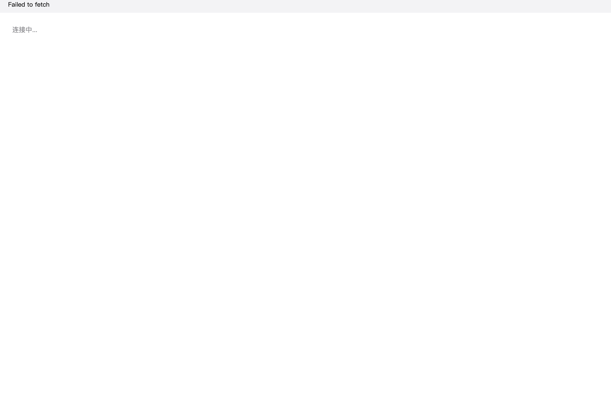

# 德州扑克（增强版）· DSH 插件

DeepSeek Harness 的六人无限注德州扑克：**你 + 5 位会说话的 LLM 智能体**。
基于 [BubblePtr/dsh-holdem](https://github.com/BubblePtr/dsh-holdem)（MIT）二次开发，改动集中在交互层。



## 这个版本多了什么

| 能力 | 说明 |
| --- | --- |
| **小窗 ⇄ 大视图** | 标题栏 `⤢ / ⤡` 一步切换。小窗 360×520 走紧凑分区布局；放大后是完整椭圆桌 + 右侧时间线栏（最多 1280×820，居中） |
| **`×` 关闭插件** | 等价于在「插件」页关掉本插件（走宿主 `pluginManager.setBundleEnabled`），只作用于自身 bundle；重开到「插件」页点开启 |
| **关闭不落盘** | 关闭状态只存在内存里，刷新或重启会重新显示，不会把自己锁在门外 |
| **放大态记忆** | 尺寸/位置/分页写在 `localStorage` 的 `texas-holdem.mini` |

规则、下注尺度、买入与出局、亮牌动效与上游一致。

## 安装

需要已安装 DeepSeek Harness（桌面版或 `dsh` CLI）。

```sh
# 桌面版（App 自带 CLI 可管理 desktop profile）
"/Applications/DeepSeek Harness.app/Contents/Resources/runtime/cli/bin/dsh" plugin --profile desktop add <本仓库目录或包路径>

# web profile
dsh plugin --profile web add <本仓库目录或包路径>
```

从本地目录安装时使用 `link:`，改完源码 `pnpm build` 后刷新页面即可生效（Host 半区改动需重启）。

卸载：

```sh
dsh plugin --profile desktop remove @local/texas-holdem
```

## 开发

```sh
pnpm install
pnpm build          # 产出 lib/index.js 与 lib/client.js（lib/ 已随仓库提交）
node --test test/*.test.mjs
```

`lib/` 是提交进仓库的构建产物：改 `src/` 后务必重新 `pnpm build`。

## 头像

`assets/avatars/` 里的**真人肖像不随本仓库分发**（肖像权原因）。缺失时每位智能体自动回退为
按 id 生成的几何头像（identicon），玩法与界面不受影响；你上传的覆盖头像走
`$DSH_HOME/texas-holdem/avatars/`，与仓库内容无关。

想启用写真头像：把 `<id>.jpg|png|webp`（`altman` / `dario` / `musk` / `liang` / `jensen`）
放进 `assets/avatars/` 再 `pnpm build`。

## 致谢

这个仓库能存在，几乎全是 [dsh-holdem](https://github.com/BubblePtr/dsh-holdem) 的功劳。
**感谢作者 BubblePtr 与各位贡献者**，把整个插件——从牌局引擎到宿主的桌面适配——写成了
可以直接拿来改的样子。

具体欠了哪些人情，说清楚：

- **牌局引擎**：`cards.js` / `pots.js` / `bets.js` / `table-rules.js` 把这些容易写错的规矩
  （边池拆分、盲注轮转、加注下限、买入出局）抽成了纯函数，我才敢只动 UI。
- **离线测试**：那套 stub 掉 `llm` 服务的 harness 让 81 个用例不用联网、不用起宿主就能跑。
  我每次改完都能立刻知道有没有碰坏规则——这是最省时间的一笔遗产。
- **桌面壳适配**：上游把「桌面版会用自定义请求头而不是 Cookie、`` 带不了头所以走媒体令牌」
  这些坑趟平了，还写进了注释。跳过这些坑，我少走至少半天弯路。
- **踩坑记录**：README 里「加注区间上界不是合理下注额」「无限买入让全下没有后果」两段，
  直接是设计决策的说明书，不是废话。
- **迷你窗的紧凑布局**：360×520 下另做一套分区布局而不是把大桌等比缩小，这个取舍我照抄了。

本仓库的改动集中在外层：可放大为大视图、`×` 关闭插件、自有身份与图标、
以及按钮命中区与层级的三处修复。详细清单见 `CHANGELOG.md` 与 `NOTICE`。

## 许可

MIT。上游版权声明原样保留在 `LICENSE`（未作任何改动）；本仓库的二次改动同样以 MIT 发布。
逐项归属、改了哪些文件、以及素材说明见 [`NOTICE`](NOTICE)。

素材方面需要单独说明一句：人物肖像的权利归各自权利人所有，**不适用 MIT**，因此不在本仓库
分发（见上文「头像」一节）；本仓库截图由自己渲染，不含第三方影像。
